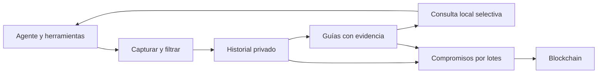

# Onchain Agent Registry

**Memoria verificable de experiencias de uso de herramientas por agentes.**

Proyecto open source en etapa de diseño conceptual, desarrollado por Santi y Mateo (auto-mode-on) para explorar un primer MVP en HackaTwin. **Este repositorio contiene documentación y diagramas, no una implementación ni resultados experimentales.**

## El problema

Los agentes suelen probar varios comandos o invocaciones hasta completar una tarea. Parte de esa exploración es necesaria; otra parte repite descubrimientos previos sobre herramientas, entornos o harnesses. Queremos reutilizar esas experiencias sin trasladar ciegamente una solución entre contextos incompatibles.

El foco es el comportamiento del agente y del harness: invocaciones incorrectas, repetición sin adaptación y confusión entre una operación aceptada y una terminada. No es principalmente una base de soluciones a bugs específicos de dependencias. El proyecto puede ser contexto relevante, pero no es siempre la unidad principal de organización.

## La propuesta

Capturar eventos observables, preparar guías breves con evidencia y condiciones, y permitir su consulta entre harnesses mediante una interfaz común. El historial queda bajo control del usuario. Blockchain respalda compromisos criptográficos del contenido; no almacena comandos ni guías privadas.

**Todas las ramas registran resultados:** si no hay guía, no es compatible o la consulta falla, el agente continúa normalmente. Una nueva solución comprobada puede generar una guía candidata o aportar evidencia a una existente; un fallo sin resolver no se publica como solución.

## Dos hipótesis independientes

1. La memoria reduce el costo total de operaciones recurrentes sin empeorar el éxito.
2. El anclaje permite detectar alteraciones posteriores del contenido comprometido.

Integridad no equivale a verdad, utilidad, captura completa ni disponibilidad. Una firma y un registro append-only son la alternativa de comparación. Blockchain agrega una referencia compartida que el operador no puede reemplazar unilateralmente bajo las garantías de la red elegida; su costo debe justificarse.

## Leer el diseño

| Documento | Contenido |
|---|---|
| [Visión y decisiones](docs/01-vision.md) | Usuarios, casos y acuerdos |
| [Arquitectura](docs/02-architecture.md) | Componentes, límites de confianza y diagramas |
| [Flujos y ejemplos](docs/03-flows.md) | Captura, consulta y nuevas experiencias |
| [Datos y protección](docs/04-data-and-trust.md) | Guías, pruebas, correcciones, privacidad |
| [POC y MVP](docs/05-poc-and-mvp.md) | Alcance, entregables y decisiones pendientes |
| [Validación económica](docs/06-validation.md) | Tiempo, dinero, tokens y experimentos |
| [Referencias](docs/07-references.md) | Proyectos relacionados y límites de lo revisado |

## Despliegue y modelo de producto

El usuario podrá ejecutar el proyecto en su equipo o infraestructura propia. El primer MVP es local, para dos harnesses. Un servicio opcional de hosting y sincronización con cifrado de extremo a extremo queda postergado hasta validar el MVP, fuera de la hackathon.

No hay red, SDK, mecanismo de claves ni integraciones seleccionados todavía. No hay token propio, trading, entrenamiento automático ni reputación comunitaria dentro del MVP.

## Estado y contribuciones

Las propuestas técnicas pendientes están identificadas en los documentos. Se aceptan discusiones y cambios de documentación mediante issues y pull requests. No publicar logs reales, secretos ni información privada en issues.

Documentación bajo licencia MIT; la elección de licencia es una propuesta editorial inicial del repositorio, no una decisión técnica del producto.
