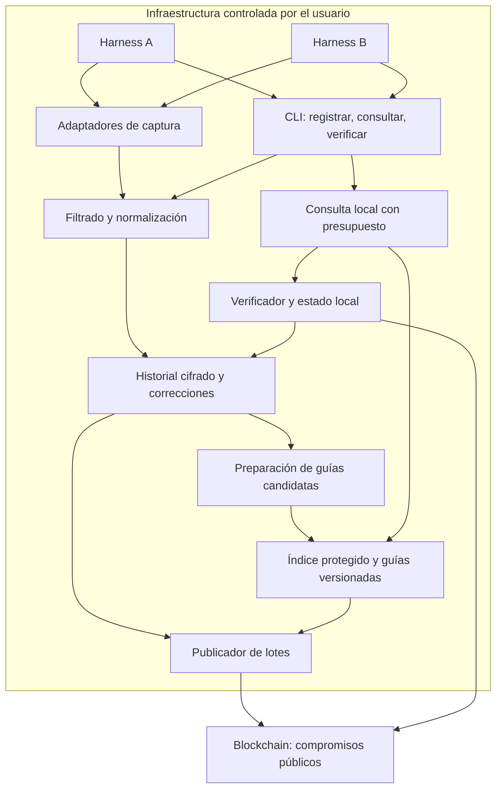

# Arquitectura conceptual

Las cajas son responsabilidades, no microservicios obligatorios. No hay tecnologías seleccionadas.

## Componentes

| Componente | Responsabilidad y límite |
|---|---|
| Adaptador | Observar eventos soportados; no garantiza captura universal |
| CLI | Interfaz común, no permiso adicional para el agente |
| Filtro | Minimizar y excluir secretos antes de persistir y comprometer |
| Historial | Retener evidencia y correcciones; necesita respaldo separado |
| Preparador | Proponer guías; no autorizar su uso sólo porque un modelo diga que funcionan |
| Índice | Recuperar candidatos compatibles sin exponer contenido sensible |
| Verificador | Comprobar contenido y prueba; no comprobar verdad o calidad |
| Publicador | Anclar lotes en segundo plano; manejar pendientes y reintentos |

## Límites de confianza

1. El harness reporta actividad: no podemos inferir eventos que omitió antes de capturarlos.
2. Los datos de herramientas y guías son contenido no confiable. No reemplazan instrucciones ni permisos.
3. La identidad del desarrollador firma y publica. Identificar un harness no certifica independientemente que ejecutó lo declarado.
4. La red confirma compromisos bajo sus reglas de finalidad y gobernanza. No guarda ni recupera el historial privado.
5. El equipo autorizado descifra contenido en uso. El cifrado no protege contra un agente autorizado que lo use indebidamente o un dispositivo comprometido.

## Camino rápido y trabajo de fondo

**Camino rápido:** filtro de consulta barato → búsqueda local acotada → condiciones y estado vigente → guía breve o ninguna recomendación.

**Fondo:** persistencia, preparación de guías, publicación de lotes, confirmaciones y actualización de correcciones. El costo de fondo igualmente cuenta en la evaluación.

Verificar de nuevo el hash local puede ser barato y detectar cambios desde la última comprobación. Reutilizar una prueba confirmada evita leer blockchain por cada comando, pero no garantiza que no haya correcciones posteriores. La política de refresco controla esa ventana.

## Futuro servicio de sincronización

Fuera del MVP: dispositivos cifran antes de enviar; el servidor almacena y sincroniza contenido cifrado; la búsqueda ocurre en dispositivos. El proveedor puede observar metadatos de conexión y tamaño. Distribución/recuperación de claves, conflictos y revocación de dispositivos requieren diseño posterior. El usuario puede desplegar infraestructura propia en vez de contratar el servicio.
