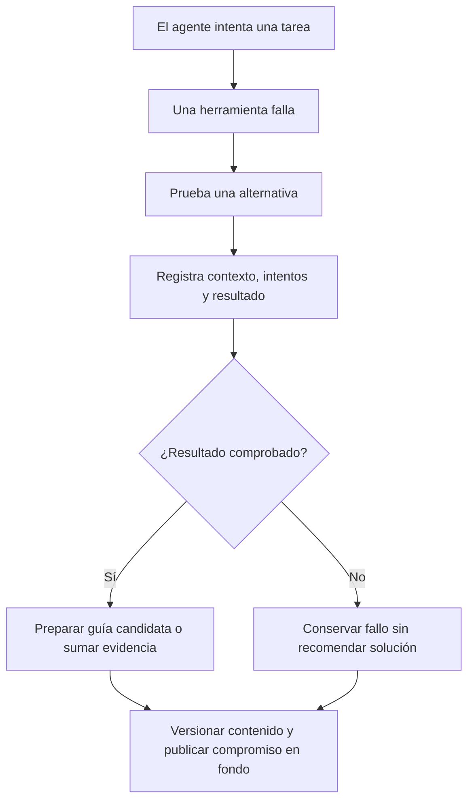
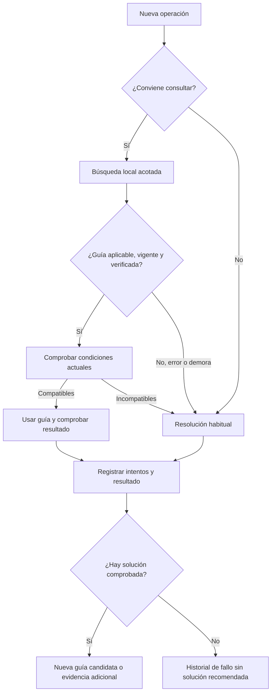
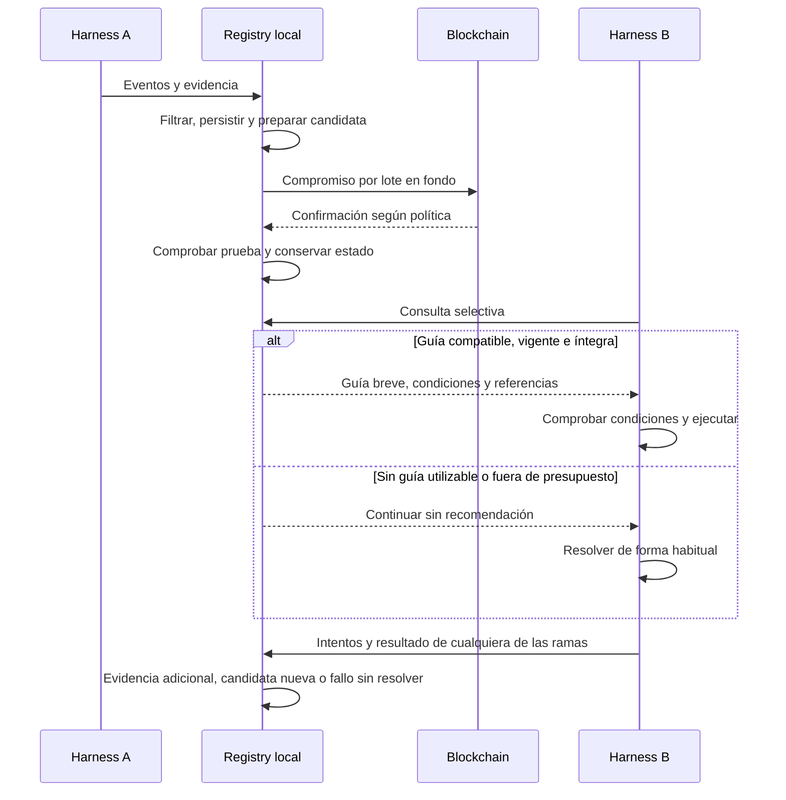

# Flujos y ejemplos

## Momento 1: descubrir una experiencia

## Momento 2: reutilizar o descubrir otra variante

**Incompatibilidad no significa que la guía original sea incorrecta.** Una experiencia Bash/Linux puede no aplicar a PowerShell/Windows. Conservaríamos ambas variantes si cada una tiene evidencia y condiciones propias.

No se crea necesariamente una guía por ejecución. La deduplicación y el aporte de evidencia evitan crecimiento y costos innecesarios. Ante indisponibilidad del registro, el trabajo continúa; se propondrá una cola local acotada cuando sea posible. Si no puede capturarse, debe quedar explícito el hueco, sin prometer historial completo.

## Ejemplo narrado

1. En el harness A, el agente intenta localizar archivos con una utilidad no disponible.
2. Prueba una alternativa y verifica que encuentra los archivos esperados.
3. Se guardan eventos filtrados y una guía candidata: objetivo, condiciones, alternativa y evidencia.
4. Se publica el compromiso en fondo. Sólo se marca verificado después de comprobar la prueba confirmada.
5. En el harness B aparece una operación parecida. El filtro considera útil consultar.
6. La búsqueda devuelve una guía breve. El agente comprueba las condiciones actuales.
7. Si coinciden, usa el antecedente. Si no, explora normalmente. En ambos casos registra el resultado.
8. Una solución nueva genera una candidata o enriquece una existente.

No afirmamos que esa consulta resulte más barata que ejecutar un comando: ésa es la hipótesis a medir.

## Secuencia técnica de referencia

