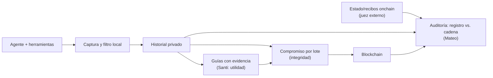

# Mapa consolidado de ideas

**Estado:** borrador de mapeo en la rama `idea/consolidated-map`, no en `main`. No decide nada ni agrega resultados: ordena dos propuestas para discutirlas. Base: `main` (Santi) + `research/onchain-agents` (Mateo).

## 1. Las dos ideas

| | Idea de Santi (`main`) | Idea de Mateo (`research/onchain-agents`) |
|---|---|---|
| Objeto | Memoria de **experiencias de uso de herramientas** por agentes (errores, reintentos, resoluciones) | Memoria/historial para **auditar lo que un agente hizo onchain** `[A CONFIRMAR con Mateo]` |
| Unidad | Evento → experiencia → guía con condiciones y evidencia ([04](04-data-and-trust.md)) | Compromisos verificables contra el estado de la cadena (recibo, postcondición del contrato) |
| Valor | Menos exploración repetida entre harnesses | Poder demostrar a un tercero qué se registró y cuándo, sin confiar en el operador |
| Blockchain | Respaldo opcional: compromisos por lotes, no almacena contenido | Referencia compartida; juez externo del resultado ([10 §5](10-validacion-onchain.md)) |
| Estado | Diseño conceptual ([01](01-vision.md)–[07](07-references.md)) | Investigación + protocolo POC ([10](10-validacion-onchain.md), [11](11-poc-simulado-onchain.md), [plan](Full-Plan-Layout.md)) |

> La columna de Mateo describe lo que está en la rama (anclaje + validación onchain). El enfoque «auditar transacciones onchain» tal como lo pensó Mateo no está escrito en el repo: validar y corregir esta columna antes de seguir.

## 2. Qué comparten

Mismo núcleo: **historial privado capturado localmente + compromisos criptográficos + verificación**. Difieren en la pregunta:

- Santi: *¿la memoria hace al agente más eficiente?* (utilidad)
- Mateo: *¿se puede comprobar que el registro no fue alterado y que coincide con lo ocurrido onchain?* (integridad/auditoría)

Ya están separadas como hipótesis independientes en el README. El mapa propone mantenerlas separadas.

## 3. Puntos de unión concretos

1. **Evento de captura = tx observada.** Un evento de herramienta que envía una tx puede llevar `chain ID`, hash, recibo y postcondición; ahí se cruzan las dos ideas.
2. **Juez externo.** El evaluador de [11](11-poc-simulado-onchain.md) (código, dueño, config en la cadena) sirve para auditar si una guía/experiencia dice la verdad sobre el resultado.
3. **Aceptada ≠ incluida ≠ finalizada.** Es el caso guía de Santi ([01](01-vision.md)) y el principal fallo documentado en [10 §2](10-validacion-onchain.md).
4. **Anclaje.** Los compromisos por lotes de [04](04-data-and-trust.md) son el mecanismo de integridad; la auditoría es su consumidor.

## 4. Tensiones a resolver

| Tema | Santi | Mateo | Pregunta abierta |
|---|---|---|---|
| Cadena | Testnet sin seleccionar | EVM local reiniciable en el POC | ¿Local para el POC y testnet después? |
| Blockchain | Opcional, medir por separado | Sólo se justifica con contraparte que desconfía del operador | ¿Quién es esa contraparte? |
| Qué se audita | Comportamiento del agente/harness | Transacciones y su coherencia con el registro | ¿Mismo registro sirve a ambos o son dos esquemas? |
| Fallo de memoria | Guía cuestionada se retira | Memoria envenenada: íntegra pero falsa | Integridad ≠ verdad ([04](04-data-and-trust.md)) |
| Alcance | MVP de 2 harnesses | POC de 1 harness y 1 modelo | ¿El POC simulado es el paso previo al MVP? ([11](11-poc-simulado-onchain.md) lo dice) |

## 5. Propuesta de siguiente paso

1. Mateo describe en 5–10 líneas su idea de auditoría (qué tx, qué se registra, quién audita) y se corrige §1.
2. Decidir si es **una** propuesta (memoria + anclaje + auditoría) o **dos** hipótesis con un registro común.
3. Si es una: fijar el esquema mínimo de evento con campos onchain (`chain ID`, hash, recibo, postcondición).
4. Seguir [Full-Plan-Layout](Full-Plan-Layout.md) sin cambios; este doc no modifica el protocolo del POC.

## Lo que este mapa no hace

No valida mercado, no agrega mediciones ni cambia decisiones aceptadas de [01](01-vision.md). Lo marcado `[A CONFIRMAR]` es mi lectura de la rama, no una afirmación de Mateo.
