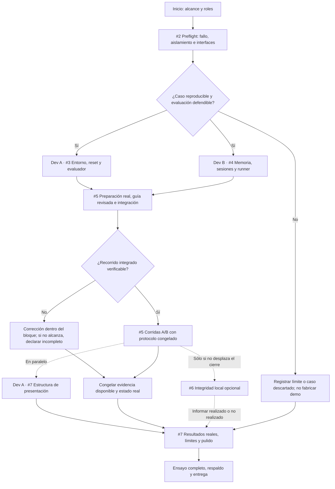

# Full-Plan-Layout

## 1. Objetivo del día y estado

Terminar una jornada de nueve horas con un POC demostrable de memoria operacional para agentes onchain, evidencia propia y una presentación ensayada. No terminar un producto comercial ni demostrar demanda de mercado.

**Estado de este documento:** plan de ejecución propuesto para dos developers, todavía no ejecutado. Los bloques son límites de trabajo para proteger el cierre, no estimaciones comprobadas ni una garantía de entrega. No hay métricas ni resultados disponibles.

**Las nueve horas incluyen:** preflight, desarrollo, integración, corridas que alcancen a completarse, análisis exploratorio, preparación/pulido de la presentación y ensayo. No son nueve horas de programación más otras horas implícitas de preparación. Pausas, incidencias y esperas del modelo consumen la misma ventana.

**No se garantiza dentro de esa ventana:** el benchmark completo de veinte corridas, un estudio exhaustivo, diseño visual elaborado, integridad opcional o validación comercial. La demo no reemplaza el benchmark; cada entrega debe declarar qué se ejecutó realmente.

Fuentes de alcance y ejecución:

- [Protocolo del POC](11-poc-simulado-onchain.md): método, controles, ejercicios y criterios de evaluación. Este layout organiza el tiempo; no modifica sus requisitos.
- [Issue coordinador #1](https://github.com/Santiagocetran/onchain-agent-registry/issues/1): backlog y dependencias.
- [Validación económica](06-validation.md): costos y amortización, sin mezclar unidades.

## 2. Qué debe quedar demostrable

Una sola familia de tareas: desplegar y configurar un contrato sencillo en una cadena EVM local, sin fondos reales.

1. **Origen:** una sesión resuelve un fallo inducido y produce evidencia comprobable; desde ella se redacta/revisa la experiencia.
2. **Reutilización:** sesiones nuevas resuelven una tarea equivalente; A tiene herramientas y playbook, B añade la experiencia local.
3. **Incompatibilidad:** ante una condición distinta, B no debe aplicar ciegamente la resolución anterior. Se observan las acciones, no sólo su declaración.
4. **Resultado externo:** un evaluador comprueba chain ID, código, propietario y configuración esperados. Un hash o «terminé» no equivalen a tarea correcta.
5. **Explicación:** la presentación distingue funcionamiento, evidencia exploratoria, benchmark completo/parcial y mercado todavía no validado.

Un harness/modelo, sesiones aisladas, un fallo y consulta local explícita. Guía manual permitida y costo de preparación visible. No frontend, plataforma, multiharness, generación automática de guías, embeddings, trading, custodia ni testnet en el camino crítico.

## 3. Preparación previa: dejar listo el recorrido, no los resultados

Si hay tiempo y las reglas de la organización lo permiten, preparar antes sólo lo que reduce fricción sin fingir ejecución:

- Leer el protocolo y repartir roles A/B; abrir el backlog y acordar dónde registrar decisiones.
- Revisar disponibilidad de equipos, conexión, cuentas de herramientas y límites de gasto; no incorporar claves al repo.
- Tener identificado el recorrido narrativo y el formato de presentación habitual del equipo.
- Preparar estructura de diapositivas: hipótesis, control/tratamiento, ejercicios, resultados y límites. Las métricas siguen sin completar.
- Confirmar con la organización rúbrica, trabajo previo permitido y requisitos de entrega. No asumir que permiten construir antes del evento.

Esta preparación es opcional y no una condición oculta de viabilidad. Si no existe al iniciar, se hace dentro de los bloques del día. No se considera preflight aprobado, demo funcionando ni estudio realizado por tener un guion.

No preparar respuestas del agente, resultados ganadores o cifras ilustrativas que después puedan confundirse con mediciones. Una grabación de respaldo sólo se obtiene de una ejecución real y se identifica como grabada.

## 4. Flujo esperado

Si se llega al cierre sin recorrido verificable, el entregable es un informe de lo comprobado y sus bloqueos, no un POC declarado completo. Un benchmark que empata o favorece A es válido; ocultarlo no lo es.

## 5. Bloques de la jornada

`H0` es el inicio efectivo del trabajo del equipo, no una hora oficial asumida. Si la ventana de trabajo es de 09:00 a 18:00, H9 coincide con la entrega, no con el comienzo de la preparación de la demo. Confirmar horarios oficiales y dejar la presentación lista antes del límite.

| Ventana | Developer A | Developer B | Salida exigida al terminar el bloque |
|---|---|---|---|
| H0–H0:45 | Comprobar stack local, fallo candidato y postcondiciones | Comprobar harness, sesiones aisladas y captura disponible | Decisión go/no-go de #2; comandos, formato y límites acordados |
| H0:45–H3:30 | #3: contrato, entorno, fallo/reinicio y evaluador externo | #4: aislamiento, consulta local, runner y resultados por ejecución | Dos paquetes con smoke propio e interfaces compatibles; sin afirmar integración todavía |
| H3:30–H4:30 | Revisar preparación, guía y verificaciones; observar acciones incompatibles | Ejecutar preparación real y smoke integrado; registrar costos y trazas | Una experiencia revisada, un par compatible, uno incompatible y continuidad sin guía observados |
| H4:30–H6:30 | Revisar evidencia y preparar narrativa/estructura de #7 | Ejecutar pares medidos de #5, alternando A/B y restableciendo cada caso | Corridas reales conservadas, con todos sus resultados y denominador exacto |
| H6:30–H7:30 | Análisis exploratorio e incorporación de resultados a la presentación | Revisar trazas, completar instrucciones reproducibles y preparar respaldo | Evidencia congelada, tabla verificable y estado completo/parcial explícito |
| H7:30–H8:30 | Pulir explicación y legibilidad, sin nuevas funcionalidades | Preparar recorrido de demo y grabación real de respaldo si corresponde | Presentación coherente con lo ejecutado; comandos y material de demo listos |
| H8:30–H9 | Ensayar, contrastar cifras y revisar entrega junto a B | Ensayar, comprobar entorno y revisar entrega junto a A | Entrega preparada, resultados respaldados y límites visibles |

No consumir el último bloque agregando features ni dejar el ensayo para después del plazo. El layout reserva tiempo de cierre incluso si el benchmark no alcanzó todas sus repeticiones. Eso no reduce su aceptación: #5 queda abierto si faltan corridas.

## 6. Reparto y contratos para trabajar en paralelo

### Antes de separarse: #2

Fijar por escrito el stack, versiones, fallo real, variante incompatible, playbook común, tareas/postcondiciones y límites por ejecución. No dar por confirmado el candidato RPC sólo porque aparece en el diseño.

Acordar comandos concretos equivalentes a estas funciones, sin construir una API o framework adicional:

- **Reset del caso:** A devuelve cadena, workspace, artefactos y fallo al estado acordado y entrega manifiesto del entorno inicial.
- **Ejecución del brazo:** B abre sesión nueva A/B, aplica presupuesto y captura traza, consulta, tiempos e intervenciones.
- **Verificación externa:** A recibe caso/evidencia y contrasta postcondiciones y acciones incompatibles, no el relato del agente.
- **Resultado por ejecución:** B registra caso, par, escenario, brazo, versiones, guía/playbook, evidencia inicial, salida del evaluador, tiempos y tokens reportados o «no disponible».

### Después del preflight

- **A posee:** entorno EVM, contrato, fallo/reinicio, evaluador y sus comprobaciones. Después revisa evidencia y prepara el informe/presentación.
- **B posee:** memoria local, aislamiento, runner, consultas y formato de resultados. Después opera las corridas y prepara la reproducción de la demo.
- Congelar rutas y un responsable para archivos compartidos. No editar simultáneamente el mismo archivo ni crear otra convención de resultados a mitad de integración.
- B puede construir captura y consulta sin esperar la guía definitiva; no puede presentar una guía ficticia como experiencia aprendida.
- Paralelizar desarrollo y análisis. No correr A y B simultáneamente sobre una misma cadena o workspace mutable.

## 7. Pasos y puertas de decisión

### Paso 1 — Confirmar viabilidad del ejercicio

A reproduce la condición del entorno y su reinicio. B comprueba que una sesión no hereda conversación ni memoria de la anterior. Ambos acuerdan cómo distinguir aplicación incompatible de mera consulta de la guía.

**Salida:** aceptación de [#2](https://github.com/Santiagocetran/onchain-agent-registry/issues/2) o registro del bloqueo. Si una regla fija o la recuperación normal ya bastan, no esconderlas al control para fabricar valor de memoria. Otro caso requiere nuevo preflight; no se consume indefinidamente el bloque de cierre buscándolo.

### Paso 2 — Construir los dos paquetes

A implementa [#3](https://github.com/Santiagocetran/onchain-agent-registry/issues/3) y B [#4](https://github.com/Santiagocetran/onchain-agent-registry/issues/4). Cada uno ejercita su camino real antes de integrar y conserva salidas. No sustituir el entorno por respuestas programadas del agente.

**Salida:** reset y evaluador verificables; runner aislado con consulta/captura; ambos respetan el contrato acordado.

### Paso 3 — Integrar y preparar la experiencia

Ejecutar una preparación separada con resultado correcto, redactar/revisar la guía y registrar ese trabajo. Verificar el recorrido compatible, incompatible y sin guía. Después congelar tareas de evaluación distintas de preparación, guía, playbook y presupuestos.

**Salida:** smoke integrado y evidencias de origen. Si no pasa, no lanzar repeticiones que sólo multipliquen un problema de integración. Corregir dentro del bloque disponible o declarar incompleto.

### Paso 4 — Medir sin contaminar el experimento

En [#5](https://github.com/Santiagocetran/onchain-agent-registry/issues/5), B opera las corridas y A inspecciona resultados mientras prepara el relato. Objetivo del protocolo: cinco pares compatibles y cinco incompatibles, aparte de preparación y smoke.

- Mismos modelos, herramientas, playbook, tarea y límites por par; B añade sólo la guía congelada.
- Reinicio y sesión nueva por ejecución; alternar orden de brazos entre pares.
- Conservar fallos y presupuestos agotados; no repetir únicamente resultados desfavorables.
- No modificar la guía durante el conjunto medido. Una corrección inicia otra versión/experimento.

**Corte de medición en H6:30:** usar límites por corrida definidos antes del benchmark para proteger el cierre. Si hay una corrida aún activa al corte, conservar su estado; una interrupción administrativa se registra como interrumpida y no se presenta como una medición completa ni un fallo intrínseco del agente. No iniciar más corridas. Reportar pares completos, ejecuciones sueltas e interrupciones por separado.

### Paso 5 — Analizar y preparar resultados

Separar resultado correcto, diagnóstico repetido, tiempo, tokens disponibles, consulta y costo de preparación. Mostrar datos por ejecución y sus referencias, además de cualquier resumen. No comparar como par completo uno al que le falta un brazo.

Declarar si B mejora, empata o empeora en esas condiciones. Una mejora por reutilización no es ahorro neto si todavía no amortiza la preparación. Las trazas y el estado real del contrato respaldan la conclusión, no una explicación retrospectiva del agente.

**Salida:** conjunto de resultados congelado y narrativa fiel. Análisis exploratorio no equivale a validación estadística o comercial.

### Paso 6 — Pulir y ensayar la demo

Completar [#7](https://github.com/Santiagocetran/onchain-agent-registry/issues/7) con datos reales. Ensayar el recorrido completo, incluida recuperación operativa: volver al estado inicial o usar una grabación de respaldo etiquetada si falla la presentación en vivo.

No usar la grabación para ocultar una regresión del benchmark ni afirmar que una toma favorable representa todas las corridas. Las correcciones del programa posteriores a medir se registran; no se atribuyen al conjunto anterior resultados de una versión que no se evaluó.

### Paso 7 — Entregar con estado explícito

Revisar los artefactos, enlaces y requisitos oficiales de entrega. Actualizar los issues según lo realmente completado y conservar abierta la evaluación pendiente. No confundir «la demo se pudo mostrar» con «el protocolo completo pasó».

## 8. Presentación preparada desde temprano

Preparar estructura durante el desarrollo, llenar cifras sólo después de observarlas:

1. **Hipótesis y usuario:** diagnóstico repetido en agentes de coding que operan contratos; demanda no validada.
2. **Ejercicio y control:** tarea, fallo inducido, postcondiciones, A/B y qué información adicional recibe B.
3. **Funcionamiento:** preparación real, reutilización e incompatibilidad; indicar en vivo/grabado.
4. **Resultados:** número real de pares, éxito, tiempo/llamadas, tokens observables y preparación separada. Incluir empates, fallos y datos no disponibles.
5. **Límites y siguiente decisión:** caso sintético, un harness, muestra exploratoria y qué falta comprobar con equipos reales.

La estructura visual y la narrativa pueden estar listas antes de los resultados; las afirmaciones no. Usar el formato que el equipo ya maneje, sin construir un dashboard o sistema de diapositivas para esta entrega.

La [integridad local #6](https://github.com/Santiagocetran/onchain-agent-registry/issues/6) se agrega sólo si no amenaza el camino crítico. Requiere guía revisada y compromiso conocido antes de alterar una copia. Si no se hace, decir «no realizado». Si se hace localmente, no presentarlo como anclaje público ni como demostración de que blockchain es necesaria.

## 9. Qué recortar si el día se complica

Orden de protección: seguridad y fidelidad de evidencia; ejercicio y controles; recorrido integrado; cierre y ensayo. No son negociables el aislamiento declarado, las postcondiciones externas, el caso incompatible ni informar fallos.

Dejar fuera primero la integridad opcional, diseño visual elaborado, nuevas métricas no disponibles y cualquier feature fuera del POC. No gastar el bloque final agregando redes, frameworks o automatizaciones.

Si no se termina el benchmark, no cambiar su objetivo para cerrar #5: mostrar evidencia parcial con denominadores exactos y dejarlo abierto. Si tampoco existe recorrido integrado verificable, presentar el estado y el bloqueo sin llamarlo POC terminado. No inventar éxitos para sostener el guion.

Si el caso confirma que el playbook fijo basta, informar ese hallazgo. Cambiar de caso requiere otra preparación/evaluación; no mezclar corridas de casos distintos como si fueran el mismo experimento.

## 10. Checklist de entrega

- [ ] Alcance y versiones registrados; sólo cuentas/fondos locales de prueba.
- [ ] Fallo y variante incompatible reales, con reinicio y aislamiento observados.
- [ ] Experiencia de preparación revisada, con origen, postcondiciones y costo visibles.
- [ ] Control A y tratamiento B preservados, sin contaminación conocida ocultada.
- [ ] Recorrido integrado ejercitado: compatible, incompatible y continuidad sin guía.
- [ ] Trazas y resultados por ejecución conservados y redactados; sin secretos en repo o slides.
- [ ] Número real de pares, interrupciones y campos no disponibles informados; estado de #5 correcto.
- [ ] Presentación sólo con métricas observadas; integridad realizada/no realizada y alcance local explícitos.
- [ ] Ensayo completo realizado; respaldo real identificado si existe y mecanismo de reinicio conocido.
- [ ] Requisitos oficiales de entrega revisados y material accesible al presentar.
- [ ] Conclusión limitada al experimento; validación con equipos y mercado pendiente.

**Criterio final:** terminar con algo verificable, explicable y ensayado; no con más código del que se puede demostrar ni con un estudio declarado completo sin sus ejecuciones.
